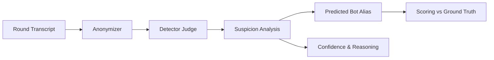

# Bot Evaluation & Detector Methodology

This document outlines the evaluation framework, statistical metrics, detector judge architecture, and benchmark criteria used to assess the imitation fidelity and covert survival of AI bot variants in **Spot the Bot**.

---

## 1. Overview & Objectives

In *Spot the Bot*, 4–7 human players and 1 covert AI bot chat anonymously about a topic under randomized per-round aliases (e.g. `Amber Lynx`, `Teal Otter`). At the end of the round, players vote on who they believe is the AI bot.

The evaluation harness (`scripts/eval_bot.py`) simulates rounds with synthetic human participants, an asynchronous event timeline, a server-authoritative state machine, and independent detector judges.

### Primary Acceptance Target
In an $N$-player game with 1 bot:
- **Random Chance Accuracy**: In a 4-player game (1 bot + 3 humans), random guessing yields:
  $$P_{\text{random}} = \frac{1}{N} = \frac{1}{4} = 25.0\%$$
- **Acceptance Criterion**: The detector judge accuracy across evaluated rounds must not exceed **$2\times$ chance**:
  $$\text{Detector Accuracy} \le 2 \times P_{\text{random}} = 50.0\%$$
  $$\text{Bot Survival Rate} = 1 - \text{Detector Accuracy} \ge 50.0\%$$

---

## 2. Statistical Metrics: 1-Wasserstein Distance ($W_1$)

To evaluate how closely the bot's conversational output matches human typing habits, we compute the **1D 1-Wasserstein Distance** (also known as the Earth Mover's Distance).

### Why Wasserstein-1 over KL Divergence?
1. **Support Invariance**: Unlike Kullback-Leibler (KL) divergence, which is undefined or infinite when probability supports do not strictly overlap ($Q(x) = 0$ while $P(x) > 0$), Wasserstein distance is a true mathematical metric defined over all empirical distributions.
2. **Physical Interpretability**: The 1-Wasserstein distance has the same physical dimension as the measured variable:
   - For message length: $W_1$ is measured in **words** or **characters**.
   - For reply latency: $W_1$ is measured in **seconds**.

### Mathematical Formulation
Given two empirical sample sets $U = \{u_1, \dots, u_n\}$ and $V = \{v_1, \dots, v_m\}$ with empirical cumulative distribution functions $F_U(x)$ and $F_V(x)$:
$$W_1(F_U, F_V) = \int_{-\infty}^{\infty} |F_U(x) - F_V(x)| \, dx$$

### Algorithmic Implementation
Because empirical CDFs are piecewise constant step functions with jumps at sorted values $\{z_1 < z_2 < \dots < z_k\} = U \cup V$, the integral is solved exactly in $O((n+m) \log(n+m))$ time:
$$W_1(F_U, F_V) = \sum_{i=1}^{k-1} (z_{i+1} - z_i) \cdot |F_U(z_i) - F_V(z_i)|$$

This computation is implemented in pure Python in `scripts/eval_bot.py` with zero external C-library dependencies.

---

## 3. Detector Judge Architecture

To avoid bias and ensure rigorous testing, detector judges evaluate anonymized round transcripts **without access to ground truth bot identities**.



### A. Heuristic & Statistical Judge
The heuristic judge analyzes feature signals that distinguish automated generation from natural human group chat:

1. **Message Length Uniformity**:
   Humans alternate between single-word acknowledgments (`"lol"`, `"same"`) and multi-clause statements, producing high standard deviation. LLMs with fixed prompting often generate uniform sentence lengths (low standard deviation).
2. **Punctuation & Formality**:
   Casual mobile party players rarely conclude chat fragments with terminal periods (`.`). High terminal period frequency increases suspicion.
3. **Colloquial & Slang Density**:
   Evaluates occurrence of informal abbreviations (`"ngl"`, `"tbh"`, `"fr"`, `"bruh"`, `"lmao"`). Lower slang density elevates suspicion.
4. **Capitalization Artifacts**:
   Strict initial capitalization on fragments (`"No way"` vs `"no way"`) contributes to formal style penalties.
5. **Answer Length & Structure**:
   Unusually balanced or lengthy opening answers contribute to suspicion.

Probabilities are calculated across participants via softmax over raw suspicion scores:
$$P(\text{seat}_i) = \frac{e^{S_i - \max(S)}}{\sum_{j} e^{S_j - \max(S)}}$$

### B. LLM Detector Judge
The LLM judge submits the complete transcript to a frontier language model prompted as an expert Turing test interrogator. The model inspects nuances, slang authenticity, and tone consistency, returning structured JSON:
```json
{
  "predicted_alias": "Teal Otter",
  "confidence": 0.42,
  "reasoning": "Teal Otter used complete sentences with formal punctuation in a casual chat setting."
}
```
If the LLM client is offline or in development mode, the judge automatically falls back to the statistical heuristic judge.

---

## 4. Simulated Human Player Profiles

To benchmark the bot realistically, the simulation harness models 3 distinct human typing archetypes:

| Profile | CPM Range | Reading Delay | Slang Prob | Style Description |
| :--- | :---: | :---: | :---: | :--- |
| **`terse_texter`** | 240–360 | 1.2–2.5s | 80% | Short 2–5 word fragments, abbreviations (`lol`, `fr`, `nah`), fast reactions. |
| **`expressive_storyteller`** | 180–290 | 2.0–4.0s | 35% | 7–18 word personal anecdotes, mixed casing, longer thoughts. |
| **`inquisitive_banterer`** | 210–320 | 1.5–3.0s | 50% | Direct questions, challenges other answers, lighthearted accusations. |

---

## 5. Variant Definitions & Tuning Targets

Three distinct bot engine configurations are tracked and compared:

1. **`baseline_v1`**:
   - CPM: 180–320.
   - Cooldown: 3.0s.
   - Reply Probability: 40%.
   - Archetype Weights: Uniform across all 4 archetypes.
2. **`terse_casual`**:
   - CPM: 240–360.
   - Cooldown: 4.0s.
   - Reply Probability: 35%.
   - Archetype Weights: Heavily biased towards `chill_casual` and `distracted_witty`.
   - Style: Lowercase, contractions, 3–8 words per message.
3. **`chatty_banterer`**:
   - CPM: 200–320.
   - Cooldown: 2.0s.
   - Reply Probability: 55%.
   - Archetype Weights: Heavily biased towards `skeptical_critic` and `enthusiastic_agreeable`.
   - Style: Engaging questions, responsive banter.

---

## 6. How to Run the Evaluation Harness

### In Docker Backend Container (Recommended)
```bash
docker compose exec -T backend python scripts/eval_bot.py \
  --variants baseline_v1,terse_casual,chatty_banterer \
  --rounds 15 \
  --seed 42 \
  --output docs/eval/variant_comparison_report.md
```

### On Host Environment
```bash
python scripts/eval_bot.py \
  --variants baseline_v1,terse_casual,chatty_banterer \
  --rounds 15 \
  --output docs/eval/variant_comparison_report.md
```
